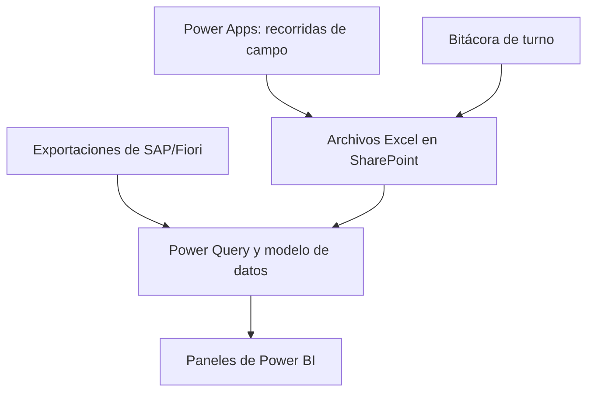

# Control Operativo con Power BI

Solución desarrollada en Microsoft Power BI para integrar, transformar y visualizar información operativa de Ciclo Simple y Ciclo Combinado, novedades de turno y seguimiento de avisos.

## Situación inicial

La información provenía de distintas fuentes y estructuras, lo que dificultaba obtener una visión consolidada de las recorridas realizadas por los Supervisores de Operaciones, los equipos inspeccionados, las novedades detectadas y el estado de los avisos.

## Objetivo

Centralizar la información operativa y convertirla en paneles que faciliten:

- El seguimiento de las recorridas de campo.
- La identificación de equipos pendientes de inspección.
- La consulta de lecturas y estados operativos.
- La consolidación de novedades.
- El seguimiento de avisos asociados a problemas en equipamientos.
- La toma de decisiones basada en información actualizada.

## Arquitectura de la solución

## Paneles principales

### Control Operativo de Ciclo Simple

Resume la información obtenida durante las recorridas de campo realizadas por los Supervisores de Operaciones.

Incluye:

- Porcentaje total de recorrida realizada.
- Seguimiento de turbinas.
- Seguimiento de compresores.
- Control de estaciones transformadoras.
- Estado de cargadores de baterías.
- Identificación de equipos pendientes de inspección.

### Control Operativo de Ciclo Combinado

Presenta el estado de las recorridas correspondientes a los equipos y sistemas del Ciclo Combinado.

Incluye:

- Bombas de distintos sistemas.
- Compresores de aire.
- Transformadores y sistema de potencia.
- Porcentaje de equipos registrados.
- Listado dinámico de equipos pendientes de inspección.

### Resumen de Novedades

Consolida las novedades procedentes de:

- Ciclo Simple.
- Ciclo Combinado.
- Bitácora de turno.

La Bitácora funciona como un libro de novedades donde se registran trabajos y eventos ocurridos durante cada turno.

El panel también permite identificar novedades que posteriormente fueron convertidas en avisos formales.

### Seguimiento de Avisos

Permite analizar avisos generados principalmente por los Supervisores de Operaciones ante problemas detectados en los equipamientos.

Incluye:

- Avisos creados.
- Avisos abiertos.
- Avisos cerrados.
- Avisos en tratamiento.
- Avisos rechazados.
- Avisos devueltos.
- Avisos duplicados.
- Filtros por fecha, usuario, equipo y estado.
- Consulta del historial y las respuestas asociadas.

## Transformación de datos

Power Query se utiliza para:

- Integrar archivos y tablas provenientes de diferentes zonas y sistemas.
- Estandarizar nombres de columnas.
- Normalizar identificadores de equipos.
- Corregir tipos de datos.
- Reemplazar errores y valores no disponibles.
- Eliminar registros duplicados.
- Consolidar novedades.
- Conservar un único registro por equipo y fecha cuando corresponde.
- Preparar exportaciones de SAP/Fiori para su análisis.

## Modelo de datos

El modelo combina tablas operativas, tablas consolidadas, calendarios y maestros de equipos.

Las relaciones permiten aplicar filtros de fecha y analizar la información procedente de múltiples fuentes dentro de una misma solución.

## Indicadores desarrollados

Entre las medidas DAX principales se encuentran:

- Porcentaje total de recorrida realizada.
- Porcentaje de turbinas inspeccionadas.
- Porcentaje de compresores inspeccionados.
- Porcentaje de estaciones transformadoras inspeccionadas.
- Equipos registrados y pendientes.
- Equipos con novedades.
- Novedades de Bitácora.
- Novedades convertidas en avisos.
- Avisos por estado de sistema y estado de usuario.

## Tecnologías utilizadas

- Microsoft Power BI
- Power Query
- Lenguaje M
- DAX
- Microsoft Excel
- Microsoft SharePoint
- Microsoft Power Apps
- Exportaciones de SAP/Fiori

## Impacto y beneficios

- Visión centralizada de la información operativa.
- Seguimiento diario de las recorridas de campo.
- Identificación rápida de equipos sin inspección.
- Estandarización de datos provenientes de diferentes fuentes.
- Mayor facilidad para consultar novedades y problemas de equipamientos.
- Seguimiento del ciclo de vida de los avisos.
- Reducción del tiempo necesario para revisar información operativa.
- Base preparada para futuras automatizaciones y análisis.

## Estado del proyecto

Primera versión operativa recientemente implementada y actualmente en evaluación y mejora continua.

## Próximos pasos

- Validar nuevas reglas de calidad de datos.
- Optimizar medidas y consultas según el uso real.
- Ampliar la documentación técnica.
- Incorporar capturas representativas de los paneles.
- Evaluar nuevas automatizaciones e implementaciones de inteligencia artificial.
