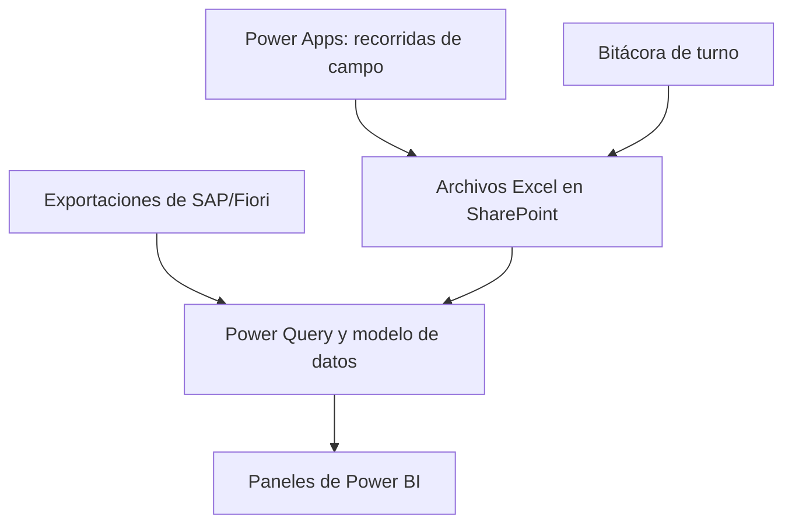
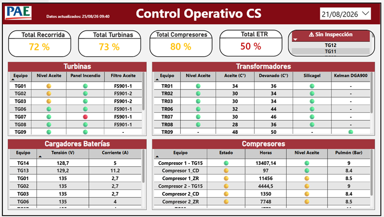
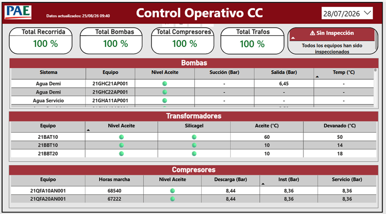
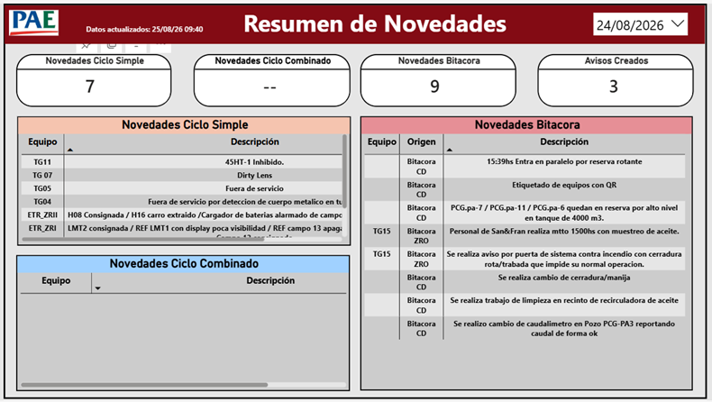
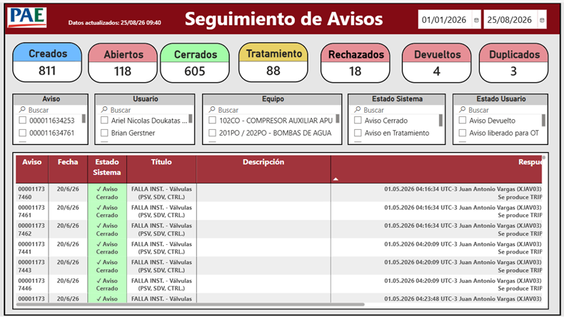
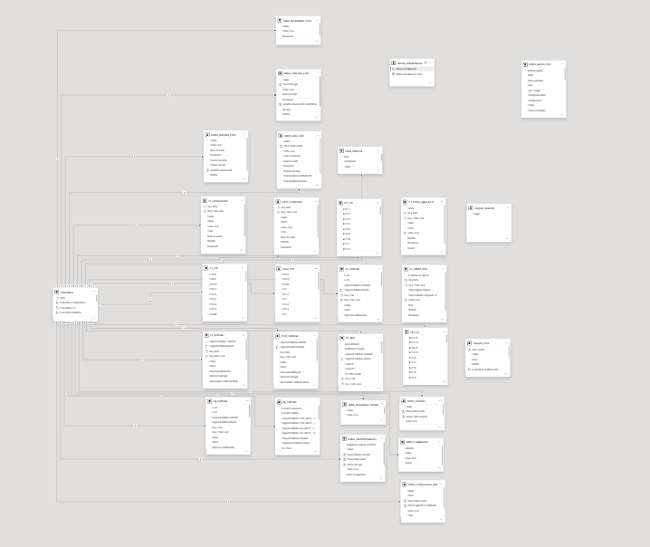

# Control Operativo con Power BI

Solución desarrollada en Microsoft Power BI para integrar, transformar y visualizar información operativa de Ciclo Simple y Ciclo Combinado, novedades de turno y seguimiento de avisos.

## Situación inicial

La información provenía de distintas fuentes y estructuras, lo que dificultaba obtener una visión consolidada de las recorridas realizadas por los Supervisores de Operaciones, los equipos inspeccionados, las novedades detectadas y el estado de los avisos.

## Objetivo

Centralizar la información operativa y convertirla en paneles que faciliten:

- El seguimiento de las recorridas de campo.
- La identificación de equipos pendientes de inspección.
- La consulta de lecturas y estados operativos.
- La consolidación de novedades.
- El seguimiento de avisos asociados a problemas en equipamientos.
- La toma de decisiones basada en información actualizada.

## Arquitectura de la solución

## Paneles principales

### Control Operativo de Ciclo Simple

Resume la información obtenida durante las recorridas de campo realizadas por los Supervisores de Operaciones.

Incluye:

- Porcentaje total de recorrida realizada.
- Seguimiento de turbinas.
- Seguimiento de compresores.
- Control de estaciones transformadoras.
- Estado de cargadores de baterías.
- Identificación de equipos pendientes de inspección.

### Control Operativo de Ciclo Combinado

Presenta el estado de las recorridas correspondientes a los equipos y sistemas del Ciclo Combinado.

Incluye:

- Bombas de distintos sistemas.
- Compresores de aire.
- Transformadores y sistema de potencia.
- Porcentaje de equipos registrados.
- Listado dinámico de equipos pendientes de inspección.

### Resumen de Novedades

Consolida las novedades procedentes de:

- Ciclo Simple.
- Ciclo Combinado.
- Bitácora de turno.

La Bitácora funciona como un libro de novedades donde se registran trabajos y eventos ocurridos durante cada turno.

El panel también permite identificar novedades que posteriormente fueron convertidas en avisos formales.

### Seguimiento de Avisos

Permite analizar avisos generados principalmente por los Supervisores de Operaciones ante problemas detectados en los equipamientos.

Incluye:

- Avisos creados.
- Avisos abiertos.
- Avisos cerrados.
- Avisos en tratamiento.
- Avisos rechazados.
- Avisos devueltos.
- Avisos duplicados.
- Filtros por fecha, usuario, equipo y estado.
- Consulta del historial y las respuestas asociadas.

### Análisis operativo y calidad de datos (actualización de octubre de 2026)

La evolución del tablero incorpora una vista analítica que relaciona novedades operativas, equipos y avisos de mantenimiento, con el objetivo de facilitar el seguimiento y la identificación de patrones.

Incluye:

- Evolución mensual de novedades diferenciadas por origen.
- Identificación de los diez equipos con mayor cantidad de novedades registradas.
- Filtros por equipo y origen para explorar la información.
- Exclusión de categorías generales, como `Planta`, del ranking específico de equipos.
- Tratamiento de valores sin equipo identificado: se distinguen registros sin equipo aplicable de posibles errores de carga.

La interpretación de los resultados considera las limitaciones de los registros de origen: una novedad sin equipo no necesariamente representa un error.

### Análisis de avisos, consignas e inhibiciones

El seguimiento de avisos se amplió con indicadores para analizar:

- Cantidad de avisos por estado: creados, abiertos, cerrados, rechazados, devueltos y duplicados.
- Porcentaje de avisos no aceptados, sujeto a la definición operativa del indicador.
- Avisos próximos a vencer, utilizando una ventana de referencia de 30 días cuando corresponde.
- Tiempo transcurrido entre la creación y la última modificación, como aproximación al seguimiento del proceso, sin equipararlo automáticamente al tiempo efectivo de resolución.
- Consignas por instalación e inhibiciones por equipo o instalación.

Las visualizaciones se encuentran sujetas a ajustes y validación durante el uso operativo.

## Capturas de la solución

### Control Operativo de Ciclo Simple

Resumen de los datos obtenidos durante las recorridas de campo realizadas por los Supervisores de Operaciones.

### Control Operativo de Ciclo Combinado

Resumen de la inspección de bombas, compresores y transformadores del Ciclo Combinado.

### Resumen de Novedades

Integración de novedades del Ciclo Simple, Ciclo Combinado y la bitácora de turno.

### Seguimiento de Avisos

Seguimiento del estado de los avisos generados por los Supervisores de Operaciones ante problemas detectados en los equipamientos.

### Modelo de datos

Vista general de las tablas, consultas y relaciones utilizadas por la solución.

> **Actualización visual pendiente:** las capturas publicadas corresponden a la documentación previa. La nueva vista de análisis se incorporará cuando se disponga de imágenes revisadas y sin información interna sensible.

## Transformación de datos

Power Query se utiliza para:

- Integrar archivos y tablas provenientes de diferentes zonas y sistemas.
- Estandarizar nombres de columnas.
- Normalizar identificadores de equipos.
- Corregir tipos de datos.
- Reemplazar errores y valores no disponibles.
- Eliminar registros duplicados.
- Consolidar novedades.
- Combinar novedades de Ciclo Simple, Ciclo Combinado y bitácoras en una estructura de análisis con campos comunes como fecha local, equipo, descripción y origen.
- Distinguir valores vacíos de equipo y categorías generales para que no distorsionen los rankings.
- Conservar un único registro por equipo y fecha cuando corresponde.
- Preparar exportaciones de SAP/Fiori para su análisis.

## Modelo de datos

El modelo combina tablas operativas, tablas consolidadas, calendarios y maestros de equipos.

Las relaciones permiten aplicar filtros de fecha y analizar la información procedente de múltiples fuentes dentro de una misma solución.

## Indicadores desarrollados

Entre las medidas DAX principales se encuentran:

- Porcentaje total de recorrida realizada.
- Porcentaje de turbinas inspeccionadas.
- Porcentaje de compresores inspeccionados.
- Porcentaje de estaciones transformadoras inspeccionadas.
- Equipos registrados y pendientes.
- Equipos con novedades.
- Novedades de Bitácora.
- Novedades convertidas en avisos.
- Avisos por estado de sistema y estado de usuario.
- Novedades por mes y por origen.
- Ranking Top 10 de equipos con mayor cantidad de novedades.
- Porcentaje de avisos no aceptados.
- Seguimiento de avisos próximos a vencer.
- Indicadores de seguimiento del tiempo entre creación y última modificación.
- Distribución de consignas e inhibiciones por equipo o instalación.

## Tecnologías utilizadas

- Microsoft Power BI
- Power Query
- Lenguaje M
- DAX
- Microsoft Excel
- Microsoft SharePoint
- Microsoft Power Apps
- Exportaciones de SAP/Fiori

## Documentación técnica

### Archivos Power Query publicados

- [Consolidación de turbinas](docs/power-query/datos-turbinas.pq)
- [Consolidación de bombas del Ciclo Combinado](docs/power-query/datos-bombas-ciclo.pq)
- [Sistema de aire del Ciclo Combinado](docs/power-query/datos-aire-ciclo.pq)
- [Sistema de potencia del Ciclo Combinado](docs/power-query/datos-potencia-ciclo.)

### Documentación por completar

- Consultas de consolidación de novedades y tratamiento de avisos de SAP/Fiori.
- Archivos de referencia de las medidas DAX utilizadas en cada panel.
- Capturas actualizadas de la vista de análisis, con datos ficticios o anonimizados.

Estos elementos se mencionan como pendientes porque todavía no están disponibles como archivos en este repositorio. No se publican consultas productivas, credenciales ni datos internos.

## Impacto y beneficios

- Visión centralizada de la información operativa.
- Seguimiento diario de las recorridas de campo.
- Identificación rápida de equipos sin inspección.
- Estandarización de datos provenientes de diferentes fuentes.
- Mayor facilidad para consultar novedades y problemas de equipamientos.
- Seguimiento del ciclo de vida de los avisos.
- Reducción del tiempo necesario para revisar información operativa.
- Base preparada para futuras automatizaciones y análisis.

## Estado del proyecto

Versión operativa publicada, con actualización programada y mejoras incorporadas al análisis de novedades, equipos y avisos. El tablero continúa en evaluación y mejora según su utilización.

## Próximos pasos

- Validar nuevas reglas de calidad de datos.
- Optimizar medidas y consultas según el uso real.
- Ampliar la documentación técnica.
- Incorporar capturas revisadas de la nueva vista analítica y actualizar las existentes cuando corresponda.
- Evaluar nuevas automatizaciones e implementaciones de inteligencia artificial.
